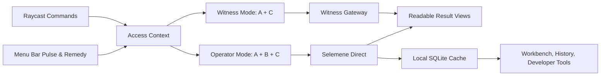

# Tryambakam Noesis

[](https://www.raycast.com/)
[](https://www.typescriptlang.org/)
[](https://react.dev/)
[](https://www.sqlite.org/)
[](./LICENSE)
[](https://github.com/Sheshiyer/noesis)

**Self-Consciousness as Technology. Body as Medium. Breath as Interface.**

Tryambakam Noesis is a Raycast practice surface for reading the current pattern: pulse cadence, Noesis Engine lenses, Daily Witness, and the next action that preserves authorship.

Witness mode exposes the Daily Ritual Cockpit and Pulse & Remedy companion without an access key. Add a Tryambakam Noesis access key to unlock the operator workbench: direct engine runs, workflow execution, reading history, raw payload tools, cache inspection, and route diagnostics.

[Quick Start](./QUICKSTART.md) · [Changelog](./CHANGELOG.md) · [GitHub Repository](https://github.com/Sheshiyer/noesis)

| Current Pattern | Engine Lens | Ritual Defaults |
| --- | --- | --- |
|  |  |  |

## Why This Surface Exists

- Raycast is the ritual layer. It should show the active pattern, the derived remedy, the next action, and the readable outcome.
- Selemene is the computational layer. It calculates engine outputs, workflows, and reading history.
- Witness is the default execution route for ordinary Daily Ritual and Pulse & Remedy runs.
- SQLite is a local continuity layer for accessibility and cache resilience, not the source of truth.

## Highlights

- Put pulse cadence first, derive the current NadaBrahman remedy, and move from remedy into action.
- Run `Daily Witness` as an overview-first one-tap ritual, with manual input edits kept as a secondary path.
- Keep `Daily Practice` available as a separate quick ritual surface in Witness mode.
- Unlock engine catalogs, workflow execution, reading history, and diagnostics only when operator access is connected.
- Read interpreted result pages first, with raw JSON retained behind explicit operator actions.
- Store secrets in Raycast preferences and keep recent history in a local SQLite cache with minimized payloads by default.

## Command Surface

| Command | What It Does |
| --- | --- |
| `Dashboard` | Daily Ritual cockpit with `Practice`, `Current Remedy`, `Pulse Inputs`, and `Recommended Now`. Operator mode also reveals the engine and flow libraries. |
| `Engines` | Operator workbench for Noesis Engine lenses, direct runs, and cached reading context. |
| `Workflows` | Operator workbench for workflow chains, engine composition, and direct multi-engine runs. |
| `Readings` | Operator archive for cached reading history, request context, and payload inspection. |
| `Ritual Defaults` | Maintain birth data, timezone, default precision, and default workflow preferences locally; operator access can also sync them to Selemene. |
| `Access Key` | Connect or rotate the Noesis access key that unlocks operator workbench surfaces. |
| `Daily Witness` | Overview-first one-tap ritual flow backed by the configured shared workflow. |
| `Daily Practice` | Run the fallback `daily-practice` workflow directly as a quick ritual surface. |
| `Developer Tools` | Operator instrumentation for connection, routing, cache, usage, and sync diagnostics. |
| `Pulse & Remedy` | Show the current NadaBrahman remedy in the menu bar, falling back to source pulse inputs when needed. |

## Access Model

- Witness mode: `Dashboard`, `Daily Witness`, `Daily Practice`, `Ritual Defaults`, and `Pulse & Remedy`.
- Operator mode: everything in Witness mode plus `Engines`, `Workflows`, `Readings`, `Access Key`, `Developer Tools`, raw payload actions, direct execution forms, cache tools, and route diagnostics.
- Raycast commands are static after install, so operator commands render a runtime access gate when no access key is connected.

## Runtime Model



## Urania 137 Design System

The extension uses the Urania 137 sacred-tech aesthetic — the visual language of the Selemene engine. All UI surfaces use a unified palette, semantic icon tinting, and sacred geometry markdown formatting.

### Palette

| Token | Hex | Usage |
| --- | --- | --- |
| Sacred Gold | `#C5A017` | Primary actions, active states, highlights |
| Witness Violet | `#2D0050` | Selected states, accent backgrounds |
| Flow Indigo | `#0B50FB` | Focus states, links, navigation |
| Coherence Emerald | `#10B5A7` | Success states, secondary actions |
| Void Black | `#070B1D` | Dark theme backgrounds |
| Parchment | `#F0EDE3` | Light theme backgrounds |

### Design Tokens

All design tokens are centralized in `src/lib/design-tokens.ts`:

- **Color constants**: `COLOR_SUCCESS`, `COLOR_WARNING`, `COLOR_ERROR`, `COLOR_INFO`, `COLOR_SELECTED`, `COLOR_PRIMARY`, `COLOR_SECONDARY`
- **Icon helpers**: `goldIcon()`, `emeraldIcon()`, `indigoIcon()`, `violetIcon()`, `mutedIcon()`, `redIcon()` — wrap `tintedIcon(icon, color)` for semantic icon tinting
- **Markdown helpers**: `cosmicHeader()`, `sacredSubheader()`, `nodeBadge()`, `phaseBadge()`, `statusDot()`, `SECTION_DIVIDER`
- **Dynamic colors**: `Color.Dynamic` variants for light/dark theme support

### Icon Semantic Mapping

| Color | Semantic Meaning | Helper |
| --- | --- | --- |
| Gold | Primary actions, key operations | `goldIcon()` |
| Emerald | Witness/observe, success states | `emeraldIcon()` |
| Indigo | Navigation, remedy, focus | `indigoIcon()` |
| Violet | Workflow, selected states | `violetIcon()` |
| Muted | Secondary, utility actions | `mutedIcon()` |
| Red | Errors, destructive actions | `redIcon()` |

### Typography

- `cosmicHeader(text)`: Renders as `# TEXT` (uppercase) for section headers
- `sacredSubheader(text)`: Renders as `## TEXT` for subsection headers
- `SECTION_DIVIDER`: Horizontal rule (`---`) for visual separation

## Privacy And Local Storage

- Secrets: the preferred storage path is the Raycast secure password preference for `apiKey`. A legacy local storage fallback still exists for compatibility.
- Ritual defaults: Witness mode can store birth data, timezone, and default workflow context locally without an access key.
- Cache: local snapshots live in `environment.supportPath/noesis-cache.sqlite`.
- Payload policy: readings and pulse snapshots are minimized before caching unless `Store Raw Payloads` is explicitly enabled.
- Retention: the reading history cache can be capped at `25`, `50`, or `100` rows.
- Clearing: personal cache data can be removed without deleting the shared engine catalog or service metadata.

## Configuration

The extension exposes the following preferences:

- `apiKey` - secure Raycast password preference for operator access
- `baseUrl` - optional Selemene base URL override
- `witnessUrl` - trusted Witness gateway URL
- `executionRoute` - `Selemene Engine` by default; `Witness Gateway` is an explicit compatibility route and is never selected silently
- `readingHistoryLimit` - local SQLite history cap
- `cacheRawPayloads` - opt-in raw JSON retention
- `pulseMode` - remedy fallback strategy (`NadaBrahman Default`, `TCM Organ`, `Biorhythm`, or `Vimshottari`)

Default Selemene base URL:

- `https://selemene.tryambakam.space`

## Getting Started

1. Open `Dashboard` in Raycast and read the current pattern.
2. Open `Ritual Defaults` if you want birth data, timezone, or a default workflow to shape Daily Ritual and Pulse & Remedy.
3. Run `Daily Witness`, `Daily Practice`, or use `Pulse & Remedy` from the menu bar.
4. Open `Access Key` only when you want operator workbench depth: direct Selemene runs, workflow execution, reading archive, raw payload actions, and diagnostics.

More setup detail lives in [QUICKSTART.md](./QUICKSTART.md).

## Development

```bash
PATH=/opt/homebrew/bin:$PATH npm install
PATH=/opt/homebrew/bin:$PATH npm run dev
```

## Verification

```bash
PATH=/opt/homebrew/bin:$PATH npx tsc --noEmit
PATH=/opt/homebrew/bin:$PATH npm test
PATH=/opt/homebrew/bin:$PATH npm run build
```

## Project Frame

The governing product language is Kha-Ba-La:

- `Kha` - observer, witness, author-drive
- `Ba` - body, vehicle, embodiment
- `La` - inertia, resistance, materiality

Tryambakam Noesis keeps that frame visible without asking the interface itself to become mystical. The product goal is practical: surface the pattern, preserve authorship, and keep the infrastructure legible.
