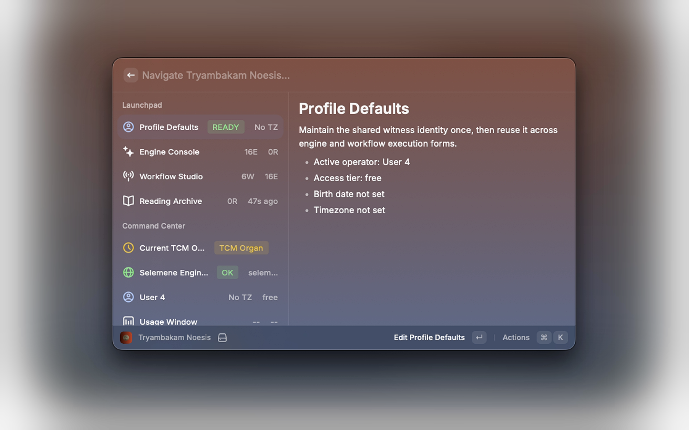
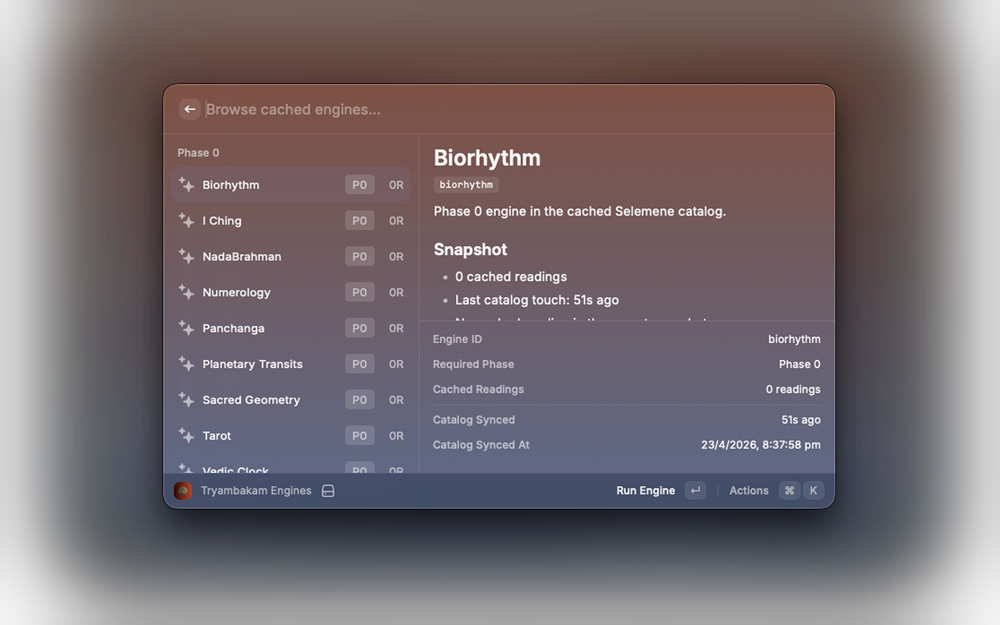
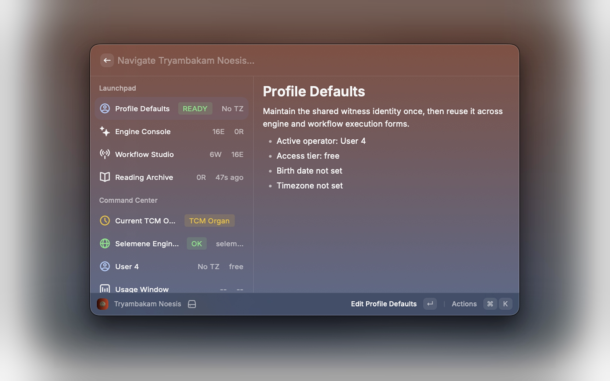
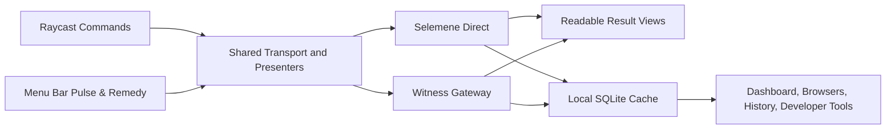

# Tryambakam Noesis

[](https://www.raycast.com/)
[](https://www.typescriptlang.org/)
[](https://react.dev/)
[](https://www.sqlite.org/)
[](./LICENSE)
[](https://github.com/Sheshiyer/noesis)

**Self-consciousness as technology. Body as medium. Breath as interface.**

Tryambakam Noesis is a native Raycast ritual surface for pulse cadence, NadaBrahman remedies, Daily Witness, and guided practice flows. It keeps the full engine and workflow catalogs available, but it now leads with the current remedy, the source pulse inputs supporting it, and the next action to take instead of presenting the extension like a backend console.

[Quick Start](./QUICKSTART.md) · [Changelog](./CHANGELOG.md) · [GitHub Repository](https://github.com/Sheshiyer/noesis)

| Dashboard | Engine Console | Profile Defaults |
| --- | --- | --- |
|  |  |  |

## Why This Surface Exists

- Raycast is the ritual layer. It should show the active pattern, the derived remedy, the next action, and the readable outcome.
- Selemene is the computational layer. It calculates engine outputs, workflows, and reading history.
- Witness is the default execution route for user-facing ritual runs, not hidden magic.
- SQLite is a local continuity layer for accessibility and cache resilience, not the source of truth.

## Highlights

- Put pulse cadence first, derive the current NadaBrahman remedy, and move from remedy into action.
- Run `Daily Witness` as an overview-first one-tap ritual, with manual input edits kept as a secondary path.
- Keep `Daily Practice` available as a separate quick ritual surface while preserving the full engine and workflow catalogs.
- Use a dedicated `Developer Tools` command for routing, cache, usage, and sync diagnostics instead of mixing them into the main dashboard.
- Read interpreted result pages first, with raw JSON retained through explicit copy actions for deeper inspection.
- Store secrets in Raycast preferences and keep recent history in a local SQLite cache with minimized payloads by default.

## Command Surface

| Command | What It Does |
| --- | --- |
| `Dashboard` | Ritual-first dashboard with `Practice`, `Current Remedy`, `Pulse Inputs`, `Recommended Now`, and the full engine and flow libraries. |
| `Engines` | Browse Selemene lenses by phase, inspect recent context, and run a new engine reading. |
| `Workflows` | Browse workflow chains, review engine composition, and execute multi-engine runs. |
| `Readings` | Review cached reading history with interpreted result pages and explicit payload copy actions. |
| `Profile` | Maintain shared birth data, timezone, default precision, and default workflow preferences. |
| `API Key` | Connect or rotate the Noesis access key, warm the cache, and manage local account state safely. |
| `Daily Witness` | Overview-first one-tap ritual flow backed by the configured shared workflow. |
| `Daily Practice` | Run the fallback `daily-practice` workflow directly as a quick ritual surface. |
| `Developer Tools` | Inspect connection, routing, cache, usage, and sync diagnostics outside the main dashboard flow. |
| `Pulse & Remedy` | Show the current NadaBrahman remedy in the menu bar, falling back to source pulse inputs when needed. |

## Runtime Model



## Privacy And Local Storage

- Secrets: the preferred storage path is the Raycast secure password preference for `apiKey`. A legacy local storage fallback still exists for compatibility.
- Cache: local snapshots live in `environment.supportPath/noesis-cache.sqlite`.
- Payload policy: readings and pulse snapshots are minimized before caching unless `Store Raw Payloads` is explicitly enabled.
- Retention: the reading history cache can be capped at `25`, `50`, or `100` rows.
- Clearing: personal cache data can be removed without deleting the shared engine catalog or service metadata.

## Configuration

The extension exposes the following preferences:

- `apiKey` - secure Raycast password preference for Selemene access
- `baseUrl` - optional Selemene base URL override
- `witnessUrl` - trusted Witness gateway URL
- `executionRoute` - `Selemene Direct` or `Witness Gateway`
- `readingHistoryLimit` - local SQLite history cap
- `cacheRawPayloads` - opt-in raw JSON retention
- `pulseMode` - remedy fallback strategy (`NadaBrahman Default`, `TCM Organ`, `Biorhythm`, or `Vimshottari`)

Default Selemene base URL:

- `https://selemene.tryambakam.space`

## Getting Started

1. Open `API Key` in Raycast.
2. Add the Selemene API key, confirm the base URL if needed, and validate the connection.
3. Leave execution routing on `Witness Gateway` unless you intentionally want the direct Selemene path for operator testing.
4. Open `Dashboard` to warm the cache, inspect `Current Remedy`, and move into `Daily Witness`, `Daily Practice`, `Engines`, `Workflows`, or `Readings`.

More setup detail lives in [QUICKSTART.md](./QUICKSTART.md).

## Development

```bash
PATH=/opt/homebrew/bin:$PATH npm install
PATH=/opt/homebrew/bin:$PATH npm run dev
```

## Verification

```bash
PATH=/opt/homebrew/bin:$PATH npx tsc --noEmit
PATH=/opt/homebrew/bin:$PATH npm run build
```

## Project Frame

The governing product language is Kha-Ba-La:

- `Kha` - observer, witness, author-drive
- `Ba` - body, vehicle, embodiment
- `La` - inertia, resistance, materiality

Tryambakam Noesis keeps that frame visible without asking the interface itself to become mystical. The product goal is practical: surface the pattern, preserve authorship, and keep the infrastructure legible.
